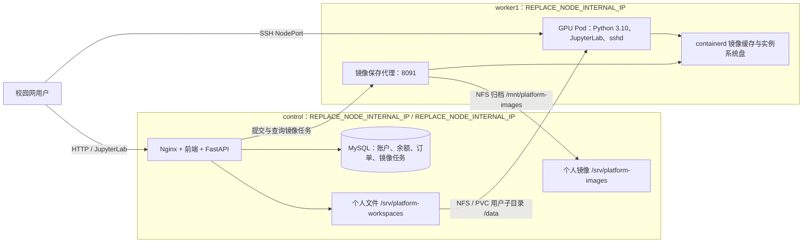

> 历史 demo 设计参考：本文描述旧环境，不是新节点验收记录。旧地址已替换为占位项；新环境以新环境部署记录.md为准。

# 校内算力平台：工作环境、个人存储与欠费规则

本版本用于校内使用，余额由管理员统一发放，不接入真实支付。账号由管理员统一创建，邮箱仅作为登录标识，不发送注册验证码。新账号初始密码统一为 password，用户可在账户设置中修改。

## 用户使用流程

1. 管理员在用户管理页创建账号，输入登录邮箱；用户使用初始密码 password 登录并可在账户设置改密。管理员再为普通用户增加余额，填写金额和说明。
2. 用户选择公共环境或已保存完成的个人镜像，以及按小时、包日或包周，申请 GPU 实例。
3. 通过 JupyterLab、网页终端或 SSH 使用同一实例。点击实例的 SSH 按钮直接复制连接命令和密码，也可使用账户设置中保存的公钥。
4. 在独立的临时 `/workspace` 运行工作；需要保留的代码、数据、模型和结果主动保存到 `/data`。系统盘中的软件、配置及临时工作文件可通过「保存镜像」保留。
5. 等待个人镜像显示「保存完成」后释放实例；以后用该镜像重新申请，个人存储仍挂载到 `/data`。

## 实际部署关系

用户实例在 worker1 上运行，训练的 CPU、主机内存和 GPU 来自同一个计算节点；control 的 CPU 用于网站、数据库、调度和文件共享。个人目录通过 NFS 直接挂载，不在每次申请时整体复制。



JupyterLab 由控制节点的 `/jupyter/<申请编号>/` 入口转发到工作节点 Ingress。SSH 使用 Kubernetes 分配的独立 NodePort，并通过可从校园网访问的控制节点 IP 连接。端口按实例分配，使用界面返回的命令。

实例密码由持久化 `SECRET_KEY` 和用户、申请编号派生，通过所属用户鉴权后返回。集群 Secret 仅接收密码哈希；临时卷中的 shadow 文件通过 `/etc/shadow` 符号链接生效，不将实例密码哈希保存到个人镜像层。保留原有 `SECRET_KEY` 才能在迁移后继续使用原实例密码；已有运行实例打开 SSH 信息时会原地启用密码登录。

## 存储位置与保留规则

| 内容 | 用户使用位置 | 实际存储位置 | 释放实例后 |
| --- | --- | --- | --- |
| 个人代码、数据、模型、结果 | `/data`、网站「我的文件」、SFTP | control 的 `/srv/platform-workspaces/user_<用户编号>/`，经 NFS/PVC 挂载 | 保留 |
| 当前实例的软件、系统配置和系统盘文件 | 容器系统盘，例如 `/workspace`、`/opt/campus-python`、`/root` | worker1 的 containerd 活跃快照 | 未保存为镜像的修改不保留 |
| 已保存的个人镜像 | 网站「我的镜像」 | control 的 `/srv/platform-images/user_<用户编号>/<保存编号>.oci.tar` | 保留，直到用户删除镜像 |
| 镜像保存任务状态 | 网站镜像保存状态 | 数据库镜像任务字段，以及 worker1 数据卷的 `/var/lib/platform-data/image-jobs/<保存编号>.json` | 保留用于恢复任务 |
| 运行中的进程、内存、GPU 内存 | 当前实例 | 当前工作负载内存 | 不保留；镜像不是进程检查点 |
| NCCL、数据加载进程的共享内存 | `/dev/shm` | 当前 Pod 独立的内存型 emptyDir，默认上限 1 GiB，按实际用量占用主机内存 | 不保留，也不进入个人镜像 |
| 余额、充值凭证、结算和审计 | 费用中心、管理后台 | control 的 MySQL | 保留 |

worker1 将镜像存储挂载为 `/mnt/platform-images`；这一路径仅供镜像保存代理使用，不挂载进普通用户 Pod。worker 上的 containerd 镜像缓存用于启动实例，个人 OCI 归档是可恢复的软件环境副本。

每个实例的临时 `/workspace` 和系统盘相互独立，同一账户的多个实例共享同一 `/data`，可以共同读取数据，也可能同时修改同名文件。不同项目建议使用不同子目录。网站上传、JupyterLab 和 SSH/SFTP 操作的是同一份文件；目录使用组继承，运行环境采用适合共享目录的文件权限，避免 SSH 创建目录后网站无法上传。

公共环境默认使用经过清理的 `campus-workbench:20261012`。每次申请都创建新可写层，不按账号或 GPU 复用旧系统；同一账号释放后租回同一张物理 GPU，也不会继承旧软件安装、系统配置、临时文件或终端历史。公共镜像构建时清除测试文件、历史、缓存及 Jupyter 运行状态，保留预装工具和发行版默认配置。只有用户显式选择个人镜像时，才恢复其主动保存的系统环境。

## 个人镜像保存与删除

保存接口提交持久化任务并返回编号，前端显示正在保存。工作节点代理核对实例归属，临时暂停实例，通过 containerd 生成系统盘增量层，随后恢复运行；使用基础镜像配置和增量层生成 OCI 归档，并导入节点缓存。系统盘数据量越大，保存需要的时间越长。

镜像只沿用基础镜像配置，不将运行时环境中的实例令牌写入配置。Jupyter 凭证、SSH 密码哈希、公钥和 SSH 主机密钥通过 Secret 或临时卷提供，这些挂载不进入系统盘镜像。`/data` 同样不进入镜像，个人文件独立保留。

保存任务会在后台查询和恢复，重复提交同一编号返回原任务。同一实例同时只允许一笔保存任务；保存期间禁止手动释放，避免生成不完整的环境。只有状态为 ready 的镜像可以申请实例。失败原因会显示在镜像目录中，用户可修正后重新保存。

删除个人镜像时先阻止新的申请，再由后台删除共享归档和节点缓存；服务暂时不可用时继续重试。仍被未结束实例使用的镜像不能删除。历史实例和费用记录继续保留，个人文件不受影响。删除外部镜像地址仅移除目录登记，不删除外部仓库内容。

当前集群仅有 worker1 提供 GPU，保存完成的镜像已导入该节点缓存。新增 GPU 节点时，需要将相应 OCI 归档导入新节点后再提供该镜像的实例申请；当前未部署跨节点镜像仓库。

## CPU、内存与 GPU 联合分配

每个节点默认先预留 20% 的 CPU 和内存给系统，余下作为用户可分配额度。实例份额 = 申请 GPU 数 ÷ 该节点登记 GPU 总数；CPU 和内存分别按这一份额计算实际限制。页面显示份额，不承诺固定的每卡 CPU/内存数值。配套费用已包含在 GPU 价格中。

节点容量来自采集服务，换用其他容量或 GPU 数量的计算节点时自动适配。CPU 配额以毫核保存，内存以 MiB 保存并向下取整，避免因整数核心或浮点误差造成超分配。以四卡节点为例，单卡、双卡、四卡分别取得用户可分配额度的四分之一、二分之一和全部。

申请在同一事务内检查 GPU、CPU 和内存，保存配额和创建意图后才执行集群操作。跨用户、跨资源池共享节点预算；CPU/内存不足时，即使 GPU 空闲也不能申请。实例使用相等的 Kubernetes requests/limits；释放中和未完成清理的失败实例继续占用预留，确认删除后才回收。重试不会重复预留，也不会让旧释放请求清除新实例的配额。

比例和实际限制在创建时冻结，运行中不随监控采样或节点扩容重新调整。CPU 限制可使用的计算时间，不绑定物理核心；内存是实例上限，`/dev/shm` 的实际占用也计入其中，超额进程可能被终止。旧固定配额订单保留原限制并标明原订单配额；更早的无配额订单不会被误标为已受限，仍保守地阻止所在节点超额分配。

## 包日、包周与历史订单规则

包日价格为小时单价 × 24 × 0.8，包周为小时单价 × 168 × 0.6，再乘申请卡数；每卡价格保留四位小数。以当前 K80 每卡每小时 5 元为例，包日 96 元、包周 504 元。

套餐下单时一次扣除余额，实例首次就绪后起算 24 小时或 7 天，截止时间持久化保存。提前释放不退费，未就绪即创建失败全额退回，重试不会重复扣款或退款。套餐不再计入按小时费用估值，也不会因账户按小时欠费被提前回收。到期自动释放；若已有镜像保存任务，先等待该任务完成或超时，不能在到期后启动新的保存任务。

我的实例仅显示正在创建、使用或释放中的实例。普通用户历史订单仅返回本人最近 10 条，管理员的历史页面可查询所有用户完整订单并分页展示；界面限制不删除数据库历史或费用明细。名称使用显卡简称与创建时间，例如 `K80-2610111341`，内部申请编号保持稳定。

## 余额与按小时实例六小时保存期

可用余额 = 当前账面余额 − 运行中及尚未结算的按小时实例预估费用。套餐金额已在下单时扣除，不重复估算。预估采用每笔申请确定的费率及持久化计费截止时间，不会因修改目录单价而改变旧实例的费率。

可用余额不超过 10 元时，控制台显示余额预警。可用余额耗尽后，新申请被拒绝，已有按小时实例继续运行六小时，以便用户保存文件和个人镜像。控制台显示明确的截止时间及剩余时间；退出网页不影响后台计时。已付款套餐按其自身到期时间释放，不套用这段保存期。

后台根据各实例的实际开始时间和冻结费率计算余额耗尽时刻，并将开始时间、截止时间保存到数据库。刷新页面和重启后端不会重新获得六小时。管理员增加余额后，只有补足欠费及未结算估值、使可用余额大于零，才取消本次保存期；不足以覆盖欠费的加款不重置倒计时。

保存期内实例仍按原费率计费。截止后后台自动释放实例，计费截止点固定为保存期截止时间；个人存储继续保留。若截止时已有镜像正在保存，会先等待已开始任务完成或超时再回收，避免破坏保存中的系统盘，计费仍截止于原定时间。镜像任务的最长后台等待时间默认为 30 分钟。

普通用户自助充值入口已移除，旧 `/billing/recharge` 接口返回 403。管理员也应使用用户管理中的增加余额操作，以保留统一的凭证和审计。

## 联网与 K80 环境

实例通过 Kubernetes DNS 解析外部域名，经 worker1 默认网关 `REPLACE_NODE_INTERNAL_IP`、control 的校园网出口和现有 NAT 访问公网。JupyterLab、SSH 和后台任务共用这一网络，用户可以使用 pip、curl、git 等工具下载依赖。

新版公共环境 `campus-workbench:20261011` 包含 Python 3.10、JupyterLab 4.2.5、OpenSSH、常用 Linux 工具和编译环境，并预装 PyTorch 1.13.1 + CUDA 11.7 及 NumPy 1.26.4，无需每次创建后重复安装。工具列表及可复现构建方式见 [公共工作环境](../deploy/workbench/README.md)。旧实例和个人镜像保持各自原环境；需要新版工具时使用新公共镜像，或在旧环境安装后保存个人镜像。

现有 Tesla K80 属于较早的 GPU，环境版本需要与其计算能力及驱动匹配；不要直接升级为面向新 GPU 的 CUDA 12 环境。

同一实例可申请多张卡并通过 PyTorch DDP / NCCL 同步训练。新实例的 `/dev/shm` 不再使用容器默认的 64 MiB，而是独立的默认 1 GiB 内存挂载，避免四卡通信初始化不足。平台配置 `WORKLOAD_SHM_SIZE_LIMIT` 可调整上限，旧实例需要保存成果后重新申请才能使用新挂载。使用命令及测量限制见 [多卡示例](../examples/multi_gpu/README.md)。

旧环境或自行制作环境时的兼容版本安装示例（新版公共镜像已预装）：

```bash
python -m pip install numpy==1.26.4 -i https://pypi.tuna.tsinghua.edu.cn/simple
python -m pip install --no-deps torch==1.13.1+cu117 --index-url https://download.pytorch.org/whl/cu117
```

大型软件包的下载速度受校园网和外部镜像站影响。可使用学校允许的镜像站，下载后核对软件发布方的 SHA256；安装完成后保存个人镜像，后续申请即可复用环境。

## 部署依赖与恢复

数据库当前版本为 `0012_storage_and_notices`，比例升级前备份位于 `/srv/platform-backups/ratio-20261011/`。此前配额备份位于 `/srv/platform-backups/compute-20261011/`，套餐备份位于 `/srv/platform-backups/plans-20261011/`。有比例订单时不能删除其份额与 CPU 精度信息；有未回收预留时不能降级 `0010`；已有已付款套餐时不能直接降级到 `0008`，参见 [数据库迁移](数据库迁移.md)。

镜像代理由 worker1 的 `platform-worker-agent` systemd 服务运行，程序位于 `/opt/platform-worker-agent/worker_agent.py`，凭据位于仅 root 可读的 `/etc/platform-worker-agent.env`。后端使用同一受保护的运行时配置接入代理；真实密钥不进入 Git。

基础环境构建文件见 `deploy/workbench/`，需要已有 `jupyter-test:latest` 基础镜像、Python 3.10.15 standalone 目录和 Linux wheel 缓存。部署服务器已有对应依赖，构建脚本会使用临时目录，不把依赖写入仓库。

Git 可以恢复代码和迁移文件；个人文件、OCI 镜像归档和数据库需要独立备份。不能用删除镜像凭证表或强制恢复非空镜像外键的方式回退已有用户历史数据。

## 数据卷、份额与备份

control 的用户文件和个人镜像归档实际位于 `/var/lib/images/platform-data/{workspaces,images}`，通过 bind mount 保留表中的访问路径；worker1 的容器缓存、活跃系统盘与 kubelet 数据迁到 `/var/lib/platform-data/{k3s,kubelet}`。工作节点提供训练 CPU、内存和 GPU，control 提供持久文件共享；申请时直接挂载个人目录，不全量复制数据。

控制数据卷预留 20%，其余为用户存储池。每用户默认存储上限为用户池的 10%，管理员可调整。文件与个人镜像按同一 ext4 project quota 统计，UID 总配额限制所有用户总写入；字节和文件数量均有限制。网站、SSH 和 Jupyter 的持久目录写入均受约束，达到额度会拒绝新增写入，原有文件不删除。页面显示相对额度的占用比例，80% 时预警。实例临时系统盘另属计算节点，不计入该个人持久存储额度。

站内提醒覆盖套餐到期、可用余额、欠费六小时保存期及个人存储。实例详情显示 CPU、内存相对冻结分配额度的使用率，缺失采样显示为空；容器内存退出记录保留 OOMKilled 原因。「我的文件」可生成单/多卡 DDP 示例，实例详情可执行环境自检。

定时备份位于 worker1 的 `/var/lib/platform-data/backups`，保存数据库、文件、镜像归档、镜像任务日志与运行配置，最近三份通过校验的备份滚动保留。03:30 定时运行，失败或镜像任务冲突时六小时后检查重试。控制卷 LVM 快照提供磁盘时点，SQL 在短暂读锁期间生成。恢复演练使用独立数据库和新目录，验证文件哈希、属主、账户余额及隔离 API，完成后清理试验数据。具体配置、现场容量和限制见 [存储部署说明](../deploy/storage/README.md)。

## 新实例的临时目录与终端（v0.9）

每次申请从所选镜像创建独立的容器可写系统盘；公共镜像给出干净的标准环境，选择个人镜像则恢复其保存时的系统和工作文件。新实例的 `/workspace` 位于计算节点的容器系统盘，不再挂载个人 NFS 目录。用户在这里下载数据、安装依赖和运行训练，释放时终止进程并删除工作负载，由运行时回收可写层。

控制节点原个人目录仍为 `/srv/platform-workspaces/user_<id>`，新实例直接挂到 `/data`。网页「我的文件」对应 `/data`。用户主动上传、写入或执行 `cp -a /workspace/my-project /data/` 后，数据才进入持久个人存储；不用整体复制计算节点工作目录。普通终端输出不会自动归档；通过平台「运行任务」提交的任务记录和日志单独保存为 `/data/.cloud-jobs`。

保存个人镜像会包含系统盘中的 `/workspace` 与 `/root` 文件；独立挂载的 `/data` 不进入镜像，释放和重新申请后继续读取当前版本。镜像缓存和跨节点备份按用户确认继续保留在计算节点，它们属于平台运行数据，不属于某个实例的临时写入层。

SSH 交互会话、远程命令、SFTP 与 Jupyter Terminal 统一以 `/workspace` 为默认工作目录。交互终端使用 Bash 登录 Shell，共用 PATH、CUDA 环境、`root@主机:目录#` 提示符、基础别名和 bash-completion。Jupyter 文件浏览器可访问整个所属容器，默认显示 `/workspace`；上一级可进入 `/data`。Bash 的 Tab 补全针对命令与路径，Python 代码补全可使用 Notebook 或 IPython。

创建操作冻结 `storage_layout=separate-v1`。没有此字段的旧实例继续沿用原 `/workspace` 持久挂载，避免升级时改动用户正在使用的目录；旧个人文件不会删除，新实例在 `/data` 访问同一份内容。CPU、内存、GPU 的比例规则和计费不变。
